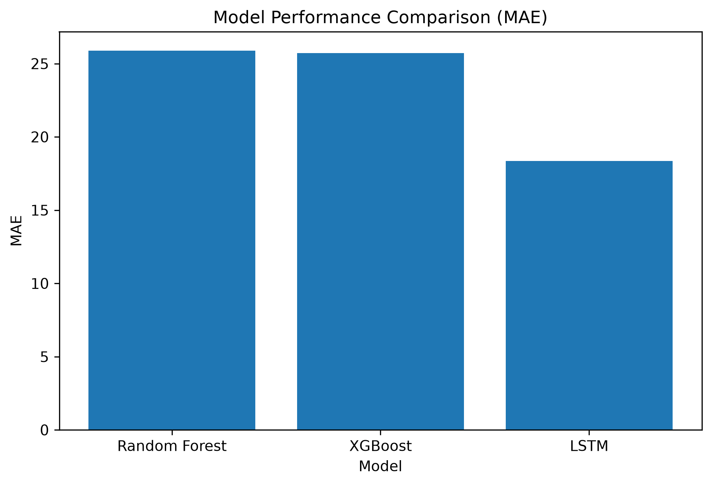
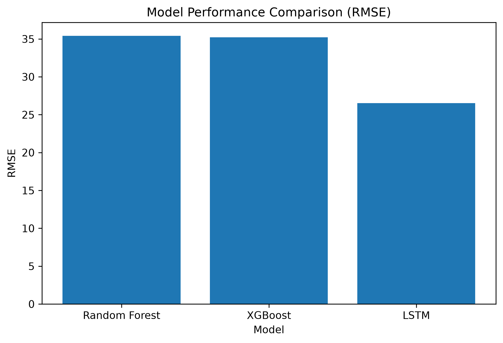
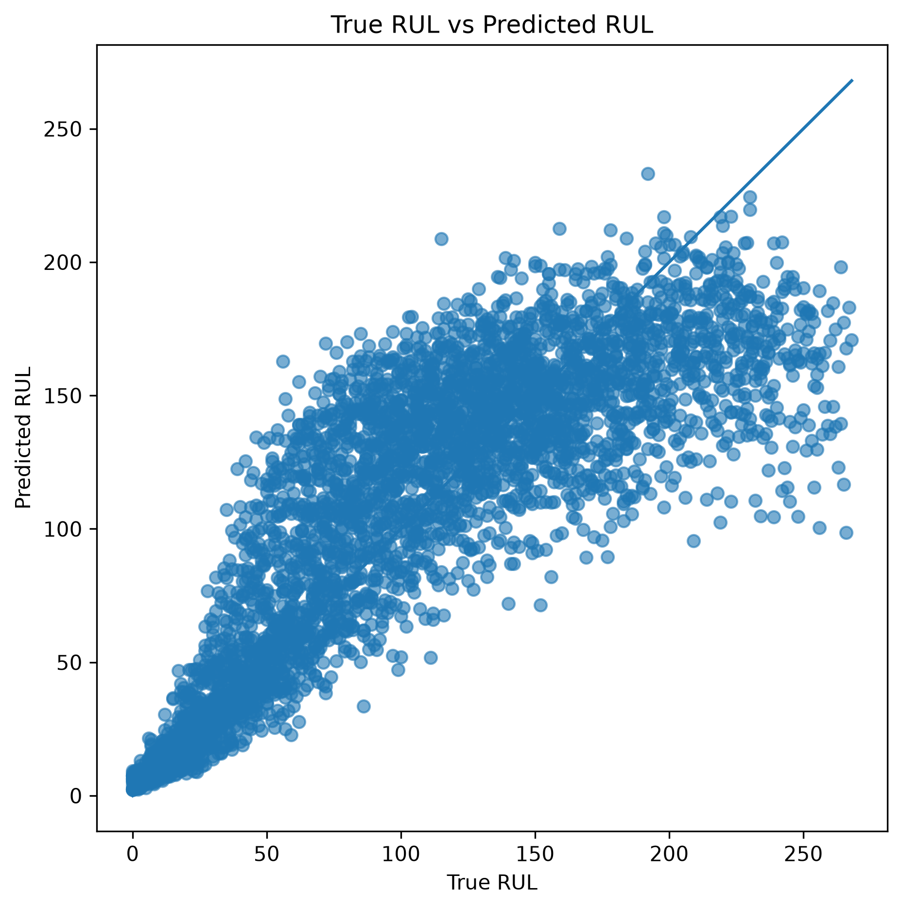
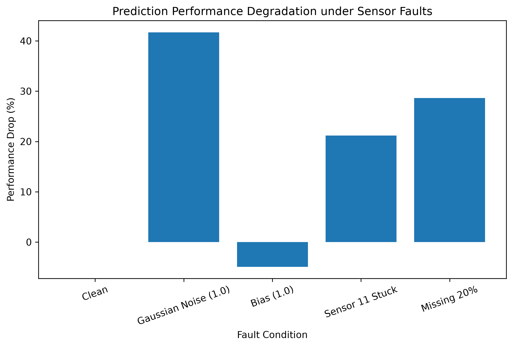
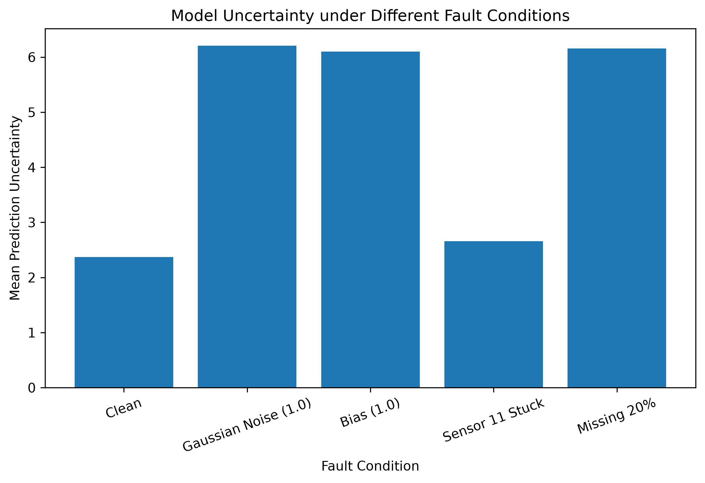
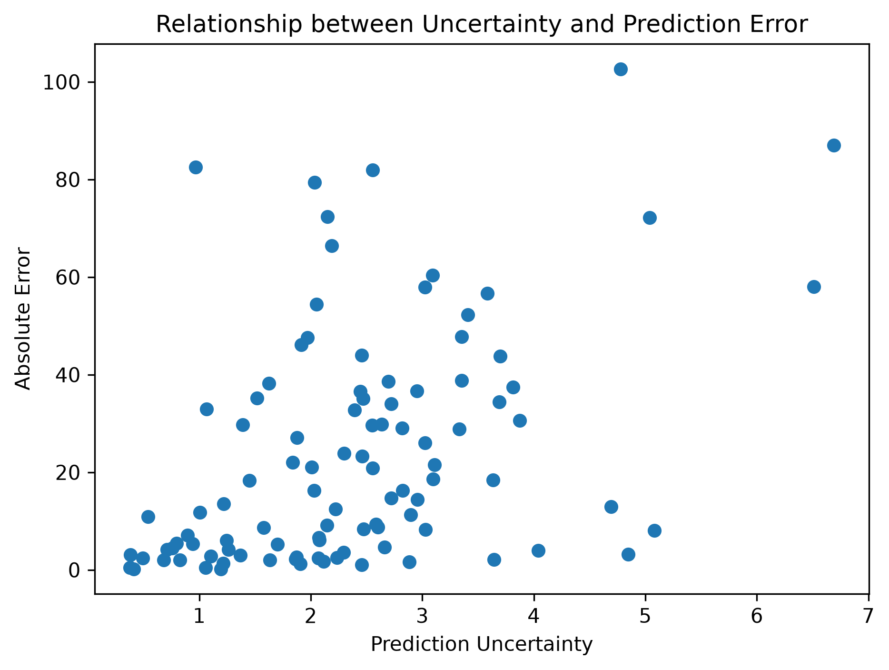

# Aviation Engine Remaining Useful Life Prediction and Reliability Analysis

基于机器学习与不确定性分析的航空发动机剩余寿命预测及可靠性评估

## Project Introduction

本项目基于 NASA C-MAPSS（Commercial Modular Aero-Propulsion System Simulation）航空发动机退化模拟数据集，完成剩余使用寿命（Remaining Useful Life, RUL）预测任务。

项目采用 Random Forest、XGBoost 和 LSTM 三类模型进行RUL预测，并进一步模拟传感器异常情况，分析模型在不同故障条件下的预测性能变化。

同时结合预测不确定性分析，评估模型预测结果在异常运行条件下的可靠程度。

## Workflow

```text
NASA C-MAPSS Dataset

        |
        v

Data Processing

        |
        v

Feature Analysis

        |
        v

Model Training

(Random Forest / XGBoost / LSTM)

        |
        v

RUL Prediction

        |
        v

Sensor Fault Simulation

(Noise / Bias / Sensor Stuck / Missing)

        |
        v

Reliability Evaluation

        |
        v

Uncertainty Analysis
```

## Dataset

本项目采用 NASA C-MAPSS FD001 数据集。

数据包括：

- 发动机运行周期信息；
- 多维传感器监测数据；
- 发动机退化过程数据。

数据路径：

```text
data
└── FD001
    ├── train_FD001.txt
    ├── test_FD001.txt
    └── RUL_FD001.txt
```

## Models

本项目采用三种模型完成航空发动机RUL预测。

### Random Forest

采用随机森林模型，根据多维传感器状态信息预测发动机剩余寿命。

### XGBoost

采用梯度提升树模型，通过迭代优化提升RUL预测性能。

### LSTM

针对发动机退化过程中的时间序列特征，利用LSTM模型学习传感器状态随时间变化规律。

三个模型基于相同数据进行训练，并采用MAE和RMSE指标进行性能比较。

## Model Comparison

### MAE Comparison



### RMSE Comparison



评价指标：

- MAE（Mean Absolute Error）
- RMSE（Root Mean Square Error）

## RUL Prediction Result

模型预测结果与真实剩余寿命进行对比。




## Reliability Evaluation

为了评估模型在异常传感器条件下的稳定性，设计以下故障场景：

| Fault Type     | Description |
| -------------- | ----------- |
| Gaussian Noise | 添加随机噪声      |
| Bias           | 添加传感器偏移     |
| Sensor Stuck   | 模拟传感器冻结     |
| Missing Data   | 模拟数据缺失      |

通过故障注入实验，分析不同异常条件对模型预测性能的影响。

### Fault Impact




## Uncertainty Analysis

进一步分析模型预测不确定性。

主要包括：

- 不同故障条件下预测不确定性变化；
- 预测误差与预测不确定性的关系。

### Uncertainty under Fault Conditions



### Error and Uncertainty Relationship




## Project Structure

```text
cmapss-rul-reliability

├── data
│   └── FD001
│       ├── RUL_FD001.txt
│       ├── test_FD001.txt
│       └── train_FD001.txt
│
├── models
│   ├── lstm_model.pth
│   ├── random_forest_model.pkl
│   └── xgboost_model.pkl
│
├── notebooks
│   └── 01_RUL_prediction_and_reliability_analysis.ipynb
│
├── results
│   ├── model_comparison.png
│   ├── model_rmse_comparison.png
│   ├── RUL_prediction.png
│   ├── fault_impact.png
│   ├── uncertainty_fault.png
│   ├── uncertainty_error.png
│   ├── model_comparison.csv
│   ├── uncertainty_results.csv
│   └── fault_performance_drop.csv
│
├── README.md
│
└── requirements.txt
```

## Environment

Python environment:

- Python 3.x
- NumPy
- Pandas
- Scikit-learn
- XGBoost
- PyTorch
- Matplotlib

## Run

安装依赖：

```bash
pip install -r requirements.txt
```

运行Notebook完成：

1. 数据读取与处理；
2. 模型训练；
3. RUL预测；
4. 故障模拟；
5. 不确定性分析。

## Conclusion

本项目完成了航空发动机剩余寿命预测模型构建，并进一步从可靠性角度分析模型在异常传感器条件下的性能变化。

通过模型对比、故障注入和不确定性分析，实现了从预测精度到模型可靠性的综合评估。
