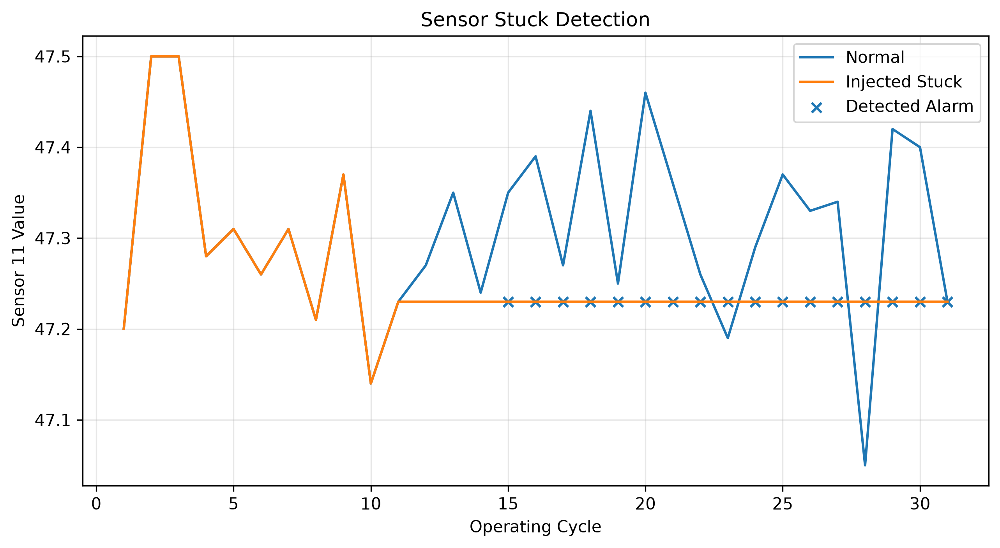
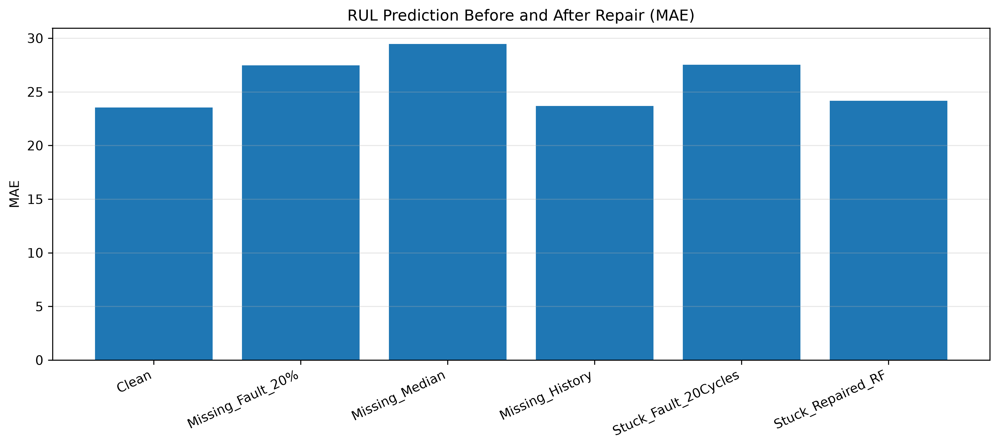
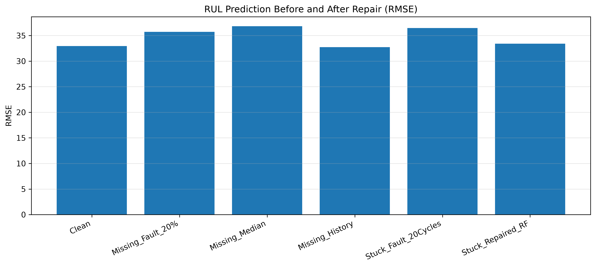
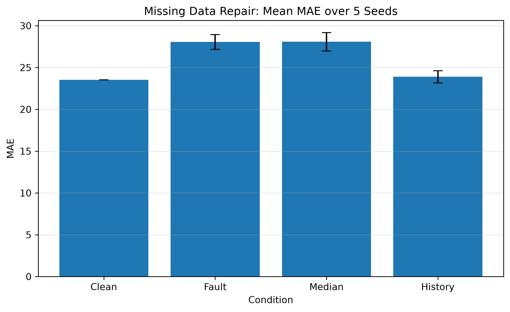
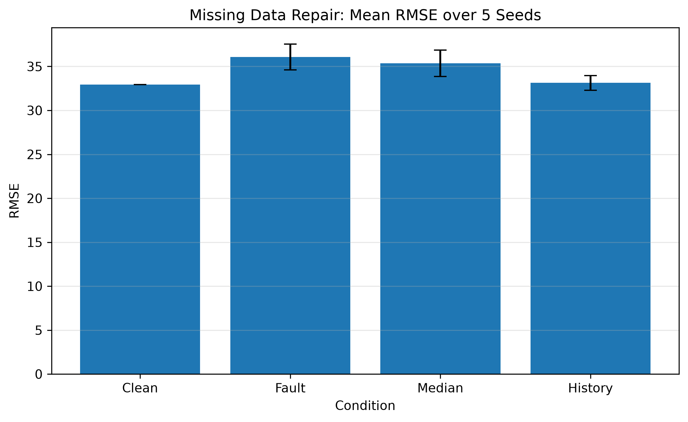

# C-MAPSS 航空发动机剩余寿命预测与可靠性分析

**Aircraft Engine Remaining Useful Life Prediction and Reliability Analysis**

基于 NASA C-MAPSS FD001 航空发动机退化模拟数据集，构建集**剩余寿命（RUL）预测、传感器故障注入、鲁棒性测试、异常检测、异常数据修复、预测性能恢复评价与不确定性分析**于一体的实验流程。项目围绕传感器数据异常对预测性能的影响，结合机器学习方法开展可靠性测试与修复效果分析。

## 1. 项目内容

| 模块 | 实现内容 |
| --- | --- |
| RUL 预测 | Random Forest、XGBoost、LSTM 模型构建与效果对比 |
| 鲁棒性测试 | 高斯噪声（Gaussian Noise）、偏移（Bias）、卡死（Sensor Stuck）、缺失（Missing Data）故障注入 |
| 异常检测 | 缺失数据识别、Sensor 11 连续卡死检测，计算 Precision、Recall、F1 |
| 异常修复 | 中位数填补（Median）、历史值填补（History）、随机森林传感器估计（RF Repair） |
| 性能恢复分析 | Clean / Fault / Repaired 条件下的 MAE、RMSE 和误差恢复率比较 |
| 重复实验 | 5 组随机种子下的 20% 缺失数据修复实验 |
| 不确定性分析 | 90% 目标覆盖水平的经验预测区间及模型集成预测分歧分析 |

### 技术流程

```text
NASA C-MAPSS FD001
        │
        ▼
数据预处理与传感器特征筛选
        │
        ▼
RUL 预测模型训练与测试（RF / XGBoost / LSTM）
        │                              └── 预测不确定性分析
        ▼
传感器故障注入（Noise / Bias / Stuck / Missing）
        │
        ▼
鲁棒性测试与误差变化分析
        │
        ▼
异常检测（Missing / Stuck）
        │
        ▼
数据修复（Median / History / RF）
        │
        ▼
修复后 RUL 预测与恢复率评价
        │
        ▼
多随机种子重复实验
```

## 2. 数据集与实验设置

使用 NASA **C-MAPSS FD001** 航空发动机退化模拟数据。训练集包含 100 台发动机的完整退化运行序列；测试集包含 100 台发动机的截断运行序列及其最后观测周期对应的真实 RUL。

经过低方差特征筛选，使用 14 个传感器特征；训练与验证按发动机编号划分。LSTM 使用长度为 30 的历史滑动窗口。

- **RUL 预测评价**：MAE、RMSE。
- **异常检测评价**：Precision、Recall、F1。
- **可靠性测试**：比较正常、故障注入和修复后的预测性能。

原始数据未存放于本仓库。运行实验时，将 `train_FD001.txt`、`test_FD001.txt` 和 `RUL_FD001.txt` 放入本地的 `data/FD001/` 目录。

## 3. 剩余寿命预测

对 Random Forest、XGBoost 和 LSTM 三种模型进行比较。以下结果来自官方测试集 **100 台发动机最后观测周期**的 RUL 预测，见 [`results/test_model_results.csv`](results/test_model_results.csv)。

| 模型 | MAE ↓ | RMSE ↓ |
| --- | ---: | ---: |
| Random Forest | 25.108 | 34.376 |
| XGBoost | 23.536 | 32.941 |
| **LSTM** | **18.395** | **27.613** |

在本次测试中，LSTM 取得三种模型中最低的 MAE 和 RMSE。RF、XGBoost 使用当前周期传感器特征，LSTM 使用历史传感器序列。


[MAE 对比图](results/model_comparison.png) · [RMSE 对比图](results/model_rmse_comparison.png)

## 4. 故障注入与鲁棒性分析

针对高斯噪声、偏移、传感器卡死和数据缺失开展故障注入，分析异常输入对 RUL 预测的影响。

以下为 XGBoost 的一组鲁棒性测试结果，见 [`results/robustness_summary.csv`](results/robustness_summary.csv)：

| 条件 | MAE ↓ | RMSE ↓ |
| --- | ---: | ---: |
| Clean | 23.536 | 32.941 |
| Gaussian Noise (1.0) | 33.350 | 43.055 |
| Bias (1.0) | 22.381 | 28.834 |
| Sensor 11 Stuck | 28.526 | 35.448 |
| Missing 20% | 30.275 | 40.551 |

结果展示不同故障对预测性能的差异化影响；特定偏移条件下误差下降反映的是该次实验设置和测试样本的结果。


## 5. 异常检测、修复与性能恢复

### 5.1 异常检测

对 20% 人工随机缺失与 Sensor 11 连续卡死 20 个周期两种故障开展检测。

| 故障类型 | Precision | Recall | F1 |
| --- | ---: | ---: | ---: |
| Missing 20% | 1.000 | 1.000 | 1.000 |
| Sensor 11 Stuck | 1.000 | 0.851 | 0.920 |

数据来源：[`results/fault_detection_metrics.csv`](results/fault_detection_metrics.csv)。缺失检测采用 `NaN` 标识识别；Sensor 11 卡死采用连续读数检测规则。本次实验识别了 36,668 个缺失位置和 1,702 / 2,000 个卡死异常周期，模拟卡死事件的平均检测延迟约为 2.98 个周期。



### 5.2 数据修复策略

- **Median**：使用训练集对应传感器的中位数填补缺失值。
- **History**：使用同一发动机的历史有效观测前向填补，必要时回退到训练集统计值。
- **Random Forest Repair**：依据其他传感器的读数预测 Sensor 11，对检测到的卡死位置进行修复。

修复后使用同一已训练的 XGBoost RUL 预测模型评估修复效果。

### 5.3 修复结果

| 实验条件 | MAE ↓ | RMSE ↓ |
| --- | ---: | ---: |
| Clean | 23.536 | 32.941 |
| Missing Fault 20% | 27.475 | 35.709 |
| Missing + Median Repair | 29.459 | 36.822 |
| Missing + History Repair | 23.672 | 32.749 |
| Sensor 11 Stuck (20 Cycles) | 27.511 | 36.457 |
| Stuck + RF Repair | 24.176 | 33.399 |

数据来源：[`results/repair_performance_comparison.csv`](results/repair_performance_comparison.csv)。

以误差指标 $E$（MAE 或 RMSE）定义恢复率：

$$
\mathrm{Recovery\ Rate}=\frac{E_{\mathrm{fault}}-E_{\mathrm{repaired}}}{E_{\mathrm{fault}}-E_{\mathrm{clean}}}\times100\%.
$$

在本次实验中，按 MAE 计算，**History 对缺失数据的误差恢复率为 96.56%**，**RF Repair 对 Sensor 11 卡死故障的误差恢复率为 83.89%**。不同修复策略的效果存在差异，Median 修复在对应实验中的恢复率为 -50.36%。





[完整恢复率结果](results/repair_recovery_summary.csv)

## 6. 多随机种子重复实验

在固定 Missing 20% 故障比例和模型设置的条件下，使用随机种子 42、43、44、45、46，比较各修复策略的表现。

| 条件 | MAE 均值 | MAE 标准差 | RMSE 均值 | RMSE 标准差 |
| --- | ---: | ---: | ---: | ---: |
| Clean | 23.536 | 0.000 | 32.941 | 0.000 |
| Fault | 28.051 | 0.878 | 36.078 | 1.458 |
| Median | 28.077 | 1.096 | 35.361 | 1.489 |
| **History** | **23.888** | **0.722** | **33.127** | **0.838** |

History 在 5/5 次重复实验中降低 MAE，五次 MAE 恢复率的算术平均值约为 **92.09%**。





[实验汇总](results/missing_multiseed_summary.csv) · [逐次结果](results/missing_multiseed_results.csv) · [恢复率明细](results/missing_multiseed_recovery.csv)

## 7. 预测不确定性分析

- **经验预测区间**：利用验证残差构建目标覆盖水平为 90% 的经验预测区间，并分析测试集覆盖情况。
- **集成预测分歧**：以不同模型预测结果的标准差衡量模型间分歧，研究其与绝对预测误差及故障条件的关系。


[预测区间数据](results/prediction_intervals_90.csv) · [集成不确定性与误差数据](results/ensemble_uncertainty_error.csv)

## 8. 项目目录

```text
C-MAPSS-RUL-Reliability-Analysis/
├── .gitattributes                       # Git LFS 跟踪配置
├── README.md
├── requirements.txt
├── data/
│   └── README.md                        # FD001 数据准备说明
├── notebooks/
│   └── 01_RUL_prediction_and_reliability_analysis.ipynb
├── models/
│   ├── lstm_model.pth
│   ├── random_forest_model.pkl          # Git LFS
│   ├── sensor11_repair_model.pkl        # Git LFS
│   └── xgboost_model.pkl
└── results/
    ├── test_model_results.csv
    ├── robustness_summary.csv
    ├── fault_detection_metrics.csv
    ├── repair_performance_comparison.csv
    ├── repair_recovery_summary.csv
    ├── missing_multiseed_summary.csv
    ├── prediction_intervals_90.csv
    ├── ensemble_uncertainty_error.csv
    ├── RUL_prediction.png
    ├── fault_impact.png
    ├── sensor_stuck_detection.png
    ├── repair_mae_comparison.png
    ├── repair_rmse_comparison.png
    ├── missing_multiseed_mae.png
    ├── missing_multiseed_rmse.png
    ├── uncertainty_fault.png
    └── uncertainty_error.png
```

## 9. 环境安装与运行

**技术栈：** Python、NumPy、Pandas、scikit-learn、XGBoost、PyTorch、Matplotlib、joblib、Jupyter Notebook、Git LFS。

### 获取项目

对于使用 Git LFS 存储的大模型，建议安装 [Git](https://git-scm.com/) 和 [Git LFS](https://git-lfs.com/)，然后执行：

```bash
git lfs install
git clone https://github.com/Sinon-dot/C-MAPSS-RUL-Reliability-Analysis.git
cd C-MAPSS-RUL-Reliability-Analysis
git lfs pull
```

仓库 `models/` 目录中提供四个模型文件：Random Forest、XGBoost、LSTM RUL 预测模型以及 Sensor 11 随机森林修复模型。

### 安装依赖

在项目根目录执行：

```bash
python -m pip install -r requirements.txt
python -m pip install notebook
```

### 准备数据与运行 Notebook

将 FD001 原始数据放入本地 `data/FD001/`，启动 Jupyter：

```bash
jupyter notebook
```

打开 [`notebooks/01_RUL_prediction_and_reliability_analysis.ipynb`](notebooks/01_RUL_prediction_and_reliability_analysis.ipynb)，按单元格顺序执行各实验模块。运行前检查 Notebook 中的 `PROJECT_ROOT`、`DATA_DIR`、`RESULTS_DIR`、`MODELS_DIR` 是否指向当前仓库；执行训练或导出步骤可能更新 `models/` 和 `results/` 内的文件。

## 10. 项目总结

本项目围绕航空发动机剩余寿命预测开展可靠性分析，形成了**预测建模—故障注入—异常检测—数据修复—性能恢复评价—不确定性分析**的完整实验流程。通过多模型预测对比、传感器故障测试和多随机种子实验，分析不同异常条件与数据修复策略对 RUL 预测效果的影响，为机器学习模型鲁棒性测试与可靠性分析提供实验案例。
